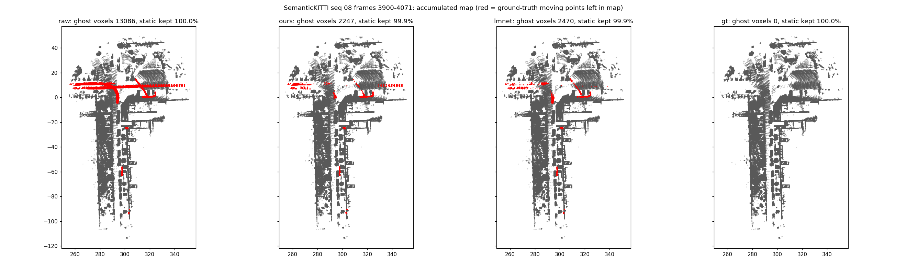

# mini-DATMO

用 LiDAR 幾何方法自動標註移動物體的小專案。

起初讀了王傑智老師等人的 *Simultaneous Localization, Mapping and Moving Object Tracking*（IJRR 2007）。實際動手做，看看論文 §7.1 用「一致性」判斷移動物體的方法，放到 3D LiDAR 上會怎麼樣。做到一半讀了 Bonn 大學的 LMNet（RA-L 2021）和 AutoMOS（RA-L 2022），發現這套流程跟 AutoMOS 的離線自動標註幾乎一樣，於是改成照 AutoMOS 的架構實作，並在 SemanticKITTI 上用同樣的指標和論文比較。

目前還在進行中，下面的數字都是用 repo 裡的程式實際跑出來的。

## 做了什麼

流程分成幾步：

1. **讀資料、對齊位置**（`kitti_io.py`）
   SemanticKITTI 的 `poses.txt` 是在左相機座標系，要用 `calib.txt` 的 `Tr` 轉成 LiDAR 座標系：`T_w_velo = inv(Tr) · P · Tr`。
   檢查方式：把第 k 幀和第 k−5 幀的點都轉到世界座標，看最近點距離的中位數。

2. **去地面、去掉自己的車身**（`ground.py`）
   把點分進 1 m 的格子，接近格子最低點的就當地面。感測器 2.8 m 以內的點是自己的車，一開始沒去掉，這些點跟著車子一起移動，結果被追蹤成一條很長的「移動物體」軌跡。

3. **一致性偵測**（`polar.py`、`consistency.py`）
   對應 IJRR 2007 §7.1。如果某個點現在的位置，在別的時刻雷射是直接穿過去的（那裡原本是空的），這個點就一定是移動進來的。
   實作上，先在參考幀建一張「每個方向第一次打到東西的距離」的極座標圖（仰角 1°、方位角 0.5°），再把目前的點轉到參考幀的感測器位置去比距離。比參考距離近超過 0.5 m + 2%·r 的點，就是候選。
   因為是離線標註，可以同時和前 5 幀、後 5 幀比較。

4. **分群**（`cluster.py`）
   在 x-y 平面上用 DBSCAN，eps = 1 m，對應論文 §5.1 的 1 m 準則。

5. **追蹤**（`tracker.py`）
   等速 Kalman filter，用馬氏距離做 gating（χ² 99%，9.21），再用匈牙利演算法配對。連續配到 3 次才確認；沒配到時繼續預測，保留 5 幀。

6. **判斷移動、輸出標籤**（`labeler.py`）
   一條 track 的淨位移超過外框長邊（AutoMOS 的規則）、軌跡夠直、候選點比例夠高，就把這條 track 所有幀的點都標成移動。
   最後再做一步修正：只標記離候選點 0.5 m 以內的點，避免把旁邊黏在一起的東西也標進去。

7. **評估**（`evaluate.py`、`eval_by_speed.py`）與**建圖**（`mapping.py`）
   IoU = TP / (TP + FP + FN)，所有幀的點加總起來算，和兩篇論文的定義相同。另外依物體當下的速度分組，分別看召回率。

## 結果

先確認評估方式沒問題：用 LiDAR-MOS 官方附的 LMNet 預測（SalsaNext，1 張殘差影像），在序列 08 算出 IoU 58.4，論文 Table I 是 59.9。

和 AutoMOS Table I 比較：

| | 資料 | P | R | IoU |
|---|---|---|---|---|
| AutoMOS：只用可見性檢查 | 訓練序列 | 76.8 | 41.2 | 36.6 |
| AutoMOS：完整方法 | 訓練序列 | 88.1 | 82.5 | 74.2 |
| 我的版本 | 序列 08（4,071 幀） | 67.9 | 42.3 | 35.3 |
| 我的版本 | 序列 07（1,101 幀，訓練序列） | 54.1 | 43.9 | 32.0 |
| 我的版本 + 修正 | 序列 08 其中 600 幀 | 86.0 | 49.6 | 45.9 |
| LMNet 官方預測 | 同上 600 幀 | 69.3 | 71.6 | 54.4 |

目前大約做到 AutoMOS「只用可見性檢查」那一行的程度。加上修正後，精確率已經接近完整方法，但召回率還差很多。

依速度分組來看（序列 08，修正前的版本）：

| 物體速度 | 占移動點 | 我的召回率 | LMNet |
|---|---|---|---|
| < 0.5 m/s | 21% | 0.0% | 42.1% |
| 0.5–2 m/s | 28% | 15.8% | 62.5% |
| > 2 m/s | 51% | 74.2% | 89.9% |

建圖（序列 08 第 3900–4071 幀，0.2 m voxel）。紅色是留在地圖裡的移動物體，也就是「鬼影」：



不做處理時有 13,101 個鬼影 voxel。用我的標籤去掉移動點後剩 3,787 個，用 LMNet 的剩 2,472 個；靜態 voxel 被誤刪的不到 0.1%。

## 觀察
- 觀察到時做出來的recall不理想，測試使用更多的幀進行比較，recall確實提升了但precision下降導致最後IoU下降。AutoMOS使用ERASOR清理整段地圖還可以維持88% recall，這個差距是之後想要弄懂的地方。
- LMNet 對停住的物體也有四成召回率。這可能是training學到的特徵。
- 誤判裡最多的是停著的車，大約占一半，其次是植被和地面。大部分是分群時黏在一起，或是車子從旁邊經過時，外框中心跟著漂移（論文 §5.5、Fig. 15）。

## 執行

```bash
pip install -r mini_datmo/requirements.txt

# 序列 08 和 LMNet 的預測：LiDAR-MOS toy dataset（https://github.com/PRBonn/LiDAR-MOS），放在 datasets/lmnet_toy_seq08/
# 其他序列：不用下載 85 GB 的整包，這個腳本用 HTTP Range 只抓指定的序列
python mini_datmo/tools/fetch_sequences.py 07 --out datasets/semantickitti
# 標籤：https://www.semantic-kitti.org/assets/data_odometry_labels.zip

cd mini_datmo
python run.py --data seq08 --out out/seq08_g5
python run.py --data seq07 --kw "refine=0.5"
python eval_by_speed.py --pred out/seq08_g5/predictions
python mapping.py --pred out/seq08_g5/predictions --frames 3900:4071
```

## 參考

- C.-C. Wang, C. Thorpe, M. Hebert, S. Thrun, H. Durrant-Whyte. Simultaneous Localization, Mapping and Moving Object Tracking. IJRR, 2007.
- X. Chen et al. Moving Object Segmentation in 3D LiDAR Data: A Learning-Based Approach Exploiting Sequential Data. RA-L, 2021.
- X. Chen et al. Automatic Labeling to Generate Training Data for Online LiDAR-Based Moving Object Segmentation. RA-L, 2022.
- J. Behley et al. SemanticKITTI: A Dataset for Semantic Scene Understanding of LiDAR Sequences. ICCV, 2019.
