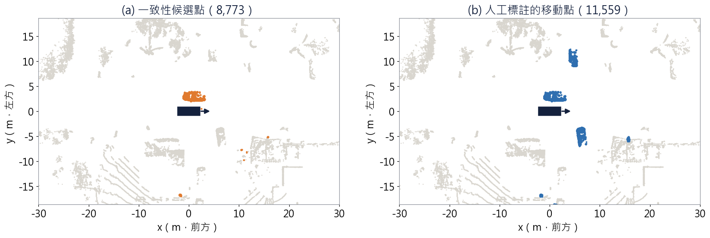
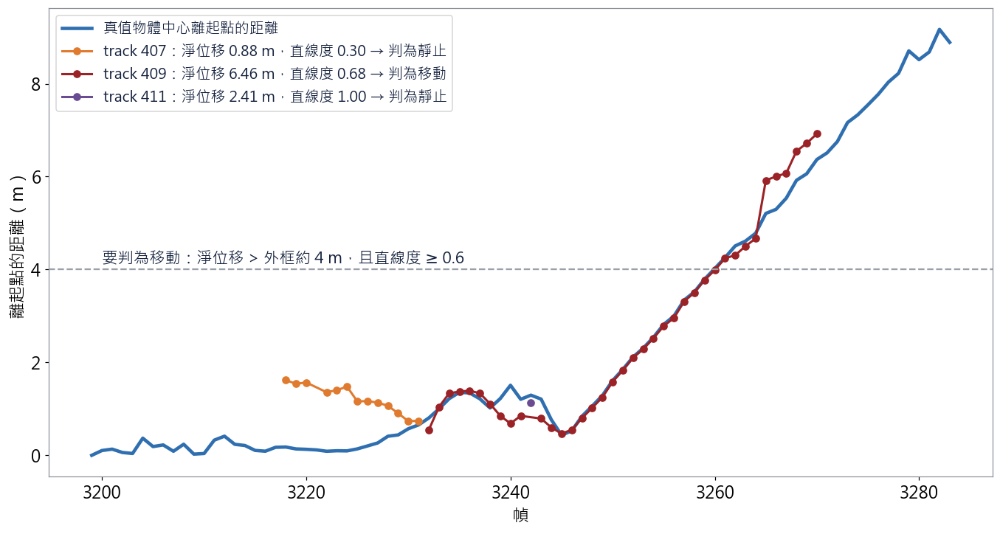

# mini-DATMO：以 LiDAR 幾何一致性自動標註移動物體

**Geometric Offline Labeling of Moving Points in LiDAR Sequences**

<p align="center">
  <br>
  <sub><b>圖 1.</b> SemanticKITTI 序列 08 第 45 幀的逐點標籤與人工標註比較。(a) 本專案，(b) LMNet [2] 官方預測。橘：正確（TP）；紅：誤判（FP）；藍：漏判（FN）。</sub>
</p>

## 摘要

移動物體分割（Moving Object Segmentation, MOS）的網路需要大量逐點標籤，而人工標註成本高。本專案使用 LiDAR 點雲與已知位姿，自動產生移動物體的逐點標籤：以 Wang 等人 [1] §7.1 的一致性判斷找出候選移動點，再參考 AutoMOS [3] 的流程，以分群、多目標追蹤與軌跡層級的判斷整理成標籤，最後以 SemanticKITTI [4] 的人工標籤評估。第一版只比較前後 0.5 秒，序列 08 的 moving IoU 為 35.7%。之後逐階段統計漏失並修改五處，影響最大的兩處是：參考幀在該方向沒有回波時不再視為看穿，以及沿著移動軌跡標註物體暫時停下的片段。目前序列 08 為 54.4%（precision 89.7%、recall 58.0%），序列 07 為 85.6%。序列 08 剩下的漏判主要來自觀察期間幾乎沒有移動的物體。以此標籤去除移動點後建圖，序列 08 `3900:4071` 幀累積地圖中的移動物體殘影減少 83%。

## 1. 方法

<p align="center">
  <br>
  <sub><b>圖 2.</b> 一致性偵測的結果。(a) 候選移動點，(b) 人工標註的移動點。人工標註另外包含兩台停在路口的車。</sub>
</p>

流程分為六個步驟，以 Python（NumPy、SciPy、scikit-learn）實作，程式在 `mini_datmo/`。

**1.1 位姿對齊。** SemanticKITTI 的位姿 $P_k$ 定義在左相機座標系。以 LiDAR 至相機的外參 $T_r$ 換到 LiDAR 座標系：

$$T^{w}_{v,k} = T_r^{-1}\, P_k\, T_r .$$

相隔 5 幀的非地面點，最近點距離中位數由未轉換時的 0.471 m 降為 0.059 m（[kitti_io.py](mini_datmo/kitti_io.py)）。

**1.2 去地面與車身。** 將點投影到 1 m × 1 m 的格子，取每格的最低點 $z_{\min}$。滿足 $z - z_{\min} < 0.25$ m 且 $z_{\min} < -1.3$ m 的點視為地面。感測器水平距離 2.0 m 以內的點視為自身車體；未排除時，這些點在世界座標中隨車移動，會被追蹤成一條很長的「移動物體」軌跡（[ground.py](mini_datmo/ground.py)）。

**1.3 一致性偵測。** 對參考幀 $j$，在其感測器座標下建立仰角 1° × 方位角 0.5° 的極座標距離圖，每格記錄光束第一次打到物體的距離 $r_{\text{ref}}$。將第 $k$ 幀的點以 $(T^{w}_{v,j})^{-1}T^{w}_{v,k}$ 轉到參考幀，若

$$r < r_{\text{ref}} - (\delta_a + \delta_r\, r), \qquad \delta_a = 0.5\ \text{m},\ \delta_r = 0.02,$$

且 $r_{\text{ref}}$ 為有限值（參考幀在該方向確實有回波），代表該點落在參考幀光束曾經穿過的空間。沒有回波的格子只代表沒有資訊；若也當成看穿，離參考幀較遠的點幾乎都會得到一票（表 3）。參考幀取 $j = k \pm \{5, 10, 20, 40, 80\}$（前後 0.5 至 8 秒，共 10 幀），其中至少 3 幀成立的點列為候選點（[polar.py](mini_datmo/polar.py)、[consistency.py](mini_datmo/consistency.py)）。[1] 將地圖轉到目前的視角比較；本專案將目前的點轉到參考幀的視角。因為目標是離線標註，可以使用未來的幀。

**1.4 分群與追蹤。** 距候選點 0.5 m（x-y 平面）以內的非地面點，以 DBSCAN 在 x-y 平面分群（$\varepsilon = 1$ m，對應 [1] §5.1）；只對候選點附近分群是 AutoMOS 的做法。最長邊小於 20 m（AutoMOS 的 $T_{\text{size}}$）且候選點比例 ≥ 0.05 的群，其中心以等速 Kalman filter 追蹤；配對以馬氏距離 $d^2 = \mathbf{y}^\top S^{-1}\mathbf{y} \le \chi^2_{2,\,0.99} = 9.21$ 作為 gate，再以匈牙利演算法求解（[cluster.py](mini_datmo/cluster.py)、[tracker.py](mini_datmo/tracker.py)）。

**1.5 軌跡層級判斷。** 一條 track 同時滿足長度 ≥ 5 幀、直線度（淨位移 ÷ 路徑長）≥ 0.6、淨位移大於外框最長邊、平均候選點比例 > 0.15，則判為移動；其所有幀的群內，距候選點 0.5 m 以內的點標為移動（[labeler.py](mini_datmo/labeler.py)）。此步驟參考 AutoMOS 的流程，但候選方法、配對與軌跡條件並不相同。

**1.6 停留延伸。** 物體停下後，參考幀不再看穿它，候選點消失，track 隨之中斷；SemanticKITTI 則將序列中移動過的物體整段標為移動。因此對判為移動的 track，若其端點的 10 幀內群中心移動不超過 2 m（物體已慢下來），就由端點的群出發，以所有非地面點逐幀繼續跟隨：以前一幀外框內的點為種子，對附近的點做 DBSCAN（$\varepsilon = 0.5$ m），取含最多種子的群；該群最長邊不超過 8 m 時記為此物體並更新外框，連續 20 幀不成立則停止。延伸結束後，只有 track 的淨位移 ≥ max(1.5 × 物體大小, 2 m) 者才採用，物體大小取延伸期間群最長邊的中位數。這個條件用來排除靜止物體上的誤判 track：其候選點只在物體表面上移動，位移不會超過物體本身的大小（[labeler.py](mini_datmo/labeler.py) 的 `_extend_stops`）。

<p align="center">
  
  <br>
  <sub><b>圖 3.</b> (a) 第 45 幀的分群，橘色為送入追蹤的群；(b) 第 0–199 幀所有 track 在世界座標中的軌跡，橘色為判為移動者。</sub>
</p>

## 2. 實驗

**資料與指標。** SemanticKITTI 序列 08（4,071 幀，移動點占 0.33%）與序列 07（1,101 幀）。Precision、recall 與 IoU $= \text{TP}/(\text{TP}+\text{FP}+\text{FN})$ 皆將評估範圍內各幀的 TP、FP、FN 加總後計算，所有點都列入（[evaluate.py](mini_datmo/evaluate.py)）。LMNet 使用 LiDAR-MOS toy dataset 附的 SalsaNext 預測（1 張殘差影像），未另外訓練網路。

**表 1.** 逐點分割結果（%）。來源：[序列 08](results/seq08_full.json)、[序列 07](results/seq07_full.json) 的 `all` 指標。

| 方法 | 評估範圍 | Precision | Recall | IoU |
|---|---|---:|---:|---:|
| 本專案 | 序列 08 全部 4,071 幀 | 89.7 | 58.0 | 54.4 |
| LMNet 官方預測 [2] | 序列 08 全部 4,071 幀 | 75.5 | 72.1 | 58.4 |
| 本專案 | 序列 07 全部 1,101 幀 | 96.1 | 88.6 | 85.6 |

SemanticKITTI-MOS 的官方評估會忽略人工標籤為 unlabeled 與 outlier 的點（序列 08 占 2.58%）。依此計算，LMNet 為 59.9%，與其論文 Table I 相同；本專案為 55.6%（序列 08）與 85.6%（序列 07）（[checks/eval_protocols.py](mini_datmo/checks/eval_protocols.py)、[結果](results/eval_protocols.txt)）。

作為方法上的參考，AutoMOS [3] Table I 在 SemanticKITTI 訓練序列上的結果為：visibility-based baseline P 76.8 / R 41.2 / IoU 36.6；完整方法（ERASOR）P 88.1 / R 82.5 / IoU 74.2。評估序列不同，數字不能直接比較；本專案也沒有重現 AutoMOS 的完整方法（候選仍是可見性檢查，不是 ERASOR）。兩個序列的結果相差 31 個百分點，也顯示數字很受序列內容影響。

**逐步修改。** 第一版只比較 $k \pm 5$ 兩幀，並對所有非地面點分群。AutoMOS Table I 中，只做地圖清理（ERASOR）為 P 20.0 / R 81.6，加上分群與追蹤後為 P 88.1 / R 82.5：召回率在候選階段就決定，追蹤主要提高精確率。因此逐階段統計人工標註的移動點在哪一步被丟掉（[checks/funnel.py](mini_datmo/checks/funnel.py)），並依結果修改（表 2）。

**表 2.** 由第一版到目前設定（%，P / R / IoU）。各列皆只標群內距候選點 0.5 m 以內的點。來源：`results/ablation_*.json`、`results/seq0{7,8}_full.json`。

| 設定 | 序列 08 | 序列 07 |
|---|---:|---:|
| (a) 第一版：參考幀 $k \pm 5$，對所有非地面點分群，群上限 8 m，車身半徑 2.8 m | 73.7 / 40.9 / 35.7 | 58.7 / 42.6 / 32.7 |
| (b) (a) + 車身半徑 2.0 m | 79.2 / 46.0 / 41.0 | 75.9 / 43.7 / 38.4 |
| (c) (b) + 參考幀至 ±8 秒且至少 3 票，只對候選點附近分群 | 73.6 / 54.8 / 45.8 | 82.2 / 57.8 / 51.4 |
| (d) (c) + 群上限 20 m | 70.6 / 54.9 / 44.6 | 82.6 / 69.7 / 60.8 |
| (e) (d) + 參考幀在該方向有回波才算看穿 | 89.8 / 56.8 / 53.4 | 96.4 / 68.6 / 66.9 |
| (f) (e) + 停留延伸（目前設定） | 89.7 / 58.0 / 54.4 | 96.1 / 88.6 / 85.6 |

- (b)：半徑 2.8 m 會把相鄰車道的車一併當成車身排除；序列 08 中被地面與車身遮罩排除的人工標註移動點由 13.6% 降為 6.3%。
- (c)：第一版中，序列 08 有 14.4% 的人工標註移動點未被分到任何群（[第一版的漏斗](results/funnel_seq08_first.txt)）；在 600 幀的開發範圍抽查，這些點幾乎都是與旁邊的牆或植被連成超過 20 m 的群而被丟掉。
- (d)：序列 07 有長度超過 8 m 的移動卡車；序列 08 則因此多了植被與建築物的誤判。
- (e)：(a)–(d) 把距離圖中沒有回波的格子（$r_{\text{ref}} = \infty$）也當成看穿。序列 08 的誤判點由 380,363 降為 106,838，recall 多 1.9 個百分點；序列 07 的 recall 少 1.1 個百分點。
- (f)：序列 07 多標出 213,234 個正確的點、10,247 個誤判點，幾乎全部來自兩台暫時停下的車；序列 08 多 19,359 個正確的點、3,418 個誤判點。
- (a)–(c) 的參數在序列 08 的 600 幀（`1500:1800`、`3000:3300`）上選定，序列 07 未用於調整。(d) 的 20 m 沿用 AutoMOS 的參數，是看過兩個完整序列的結果後才採用。(e) 是修正判斷條件，沒有新增參數；其他參數在開發範圍重新檢查後維持不變。(f) 的三個門檻是看過兩個完整序列的結果後定的。因此 (d)–(f) 的數字不能當作未見資料上的表現。

**表 3.** 候選階段的結果（%），序列 08 每 10 幀取 1 幀。物體召回率：同一個人工標註物體中候選點比例 ≥ 5% 時，其所有點視為召回。後三欄是依速度分組的物體召回率，分組定義見表 4。來源：[要求回波](results/candidate_recall_seq08.txt)、[不要求回波](results/candidate_recall_seq08_noreturn.txt)；序列 07 見 `results/candidate_recall_seq07*.txt`。

| 參考幀 | 票數 | 要求回波 | 候選點 precision | 物體召回率 | 暫停 | 慢速 | 快速 |
|---|---:|:---:|---:|---:|---:|---:|---:|
| $k \pm 5$（第一版） | 1 | 否 | 7.6 | 68.6 | 8.1 | 61.1 | 96.1 |
| 至 ±8 秒（表 2 的 (d)） | 3 | 否 | 23.1 | 69.2 | 5.7 | 66.2 | 95.3 |
| 至 ±64 秒 | 1 | 否 | 2.6 | 93.7 | 77.6 | 97.6 | 98.1 |
| $k \pm 5$ | 1 | 是 | 38.8 | 65.6 | 2.1 | 54.5 | 96.1 |
| 至 ±8 秒 | 1 | 是 | 23.0 | 80.3 | 33.3 | 81.3 | 98.0 |
| 至 ±8 秒（目前設定） | 3 | 是 | 78.1 | 69.2 | 5.7 | 66.2 | 95.3 |
| 至 ±64 秒 | 1 | 是 | 22.8 | 80.3 | 33.3 | 81.3 | 98.0 |

要求回波之後，目前設定的候選點 precision 由 23.1% 升為 78.1%，物體召回率不變。不要求回波時，把參考幀拉長到 ±64 秒，物體召回率看似可達 93.7%；要求回波後只有 80.3%，而且與「至 ±8 秒」相同，表示 ±16 秒以外的參考幀沒有提供任何有回波的看穿證據。先前較高的數字來自沒有回波的格子，並不是真的觀察到該位置變空。因此在這個做法下，拉長時間範圍無法補上暫時停下的移動物體。

**表 4.** 依估計速度分組的 recall（%）。速度由人工標註物體的點雲中心在前後幀的位移估計；遮擋與可見表面改變也會使中心漂移，因此分組只是近似。三組都只包含人工標註為移動的點：「暫停」是移動物體暫時停下時的點（例如等紅燈的車）；整段序列都沒有移動的物體（例如路邊停放的車）在人工標註中是靜止，不在任何一組。來源：[序列 08](results/seq08_by_speed.json)、[序列 07](results/seq07_by_speed.json)。

| 分組（估計速度） | 占序列 08 移動點（約） | 本專案（08） | LMNet（08） | 本專案（07） |
|---|---:|---:|---:|---:|
| 暫停（< 0.5 m/s） | 21 | 6.8 | 42.1 | 84.8 |
| 慢速（0.5–2 m/s） | 28 | 39.7 | 62.5 | 80.1 |
| 快速（> 2 m/s） | 51 | 89.1 | 89.9 | 91.3 |

**誤差分析。** SemanticKITTI 中，物體只要在序列中移動過，整段都標為移動，包含它暫時停下的那些幀；這些點即表 4 的「暫停」分組。暫停的點集中在少數幾個物體上（[序列 08](results/stopped_objects_seq08.txt)、[序列 07](results/stopped_objects_seq07.txt)）：

- 序列 07 暫停的點有 88% 來自兩台暫時停下的車。它們移動的片段已被追蹤到，停留延伸因此能接著標出停下後的片段，暫停分組的 recall 由 0.7% 升為 84.8%。
- 序列 08 暫停的點有 57% 來自開頭的兩台車（占全部人工標註移動點的 12%）。它們在可見的約 12 秒內，點雲中心的位移不到 1.5 m；本專案幾乎沒有把它們判為移動（兩台車合計只有 1 幀被標到），停留延伸也就無從開始。[1] §7.1 亦指出一致性判斷無法偵測暫時停下的移動物體。

對快速物體，本專案與 LMNet 的 recall 接近；差距集中在暫停與慢速的物體。第 1.3–1.5 節的步驟結束時，序列 08 的人工標註移動點有 27.3% 未被分到任何群（只有候選點附近的點會分群；暫停的物體為 81.0%），5.6% 因 track 的直線度不足被判為靜止（慢速物體為 18.1%）（[漏斗](results/funnel_seq08.txt)）。誤判方面，這三個步驟在序列 08 產生 106,838 個誤判點：37% 來自完全不含人工標註移動點的 track（植被占全部誤判的 15%、樹幹 6%），63% 是移動物體的群裡混入的其他點，其中人工標籤為 unlabeled 的點占全部誤判的 34%、路面占 11%。

<p align="center">
  <br>
  <sub><b>圖 4.</b> 一台由停止起步的車（序列 08）。群中心的抖動使軌跡斷成三段：track 409 的淨位移 6.46 m，判為移動；另外兩段的長度或直線度不足，判為靜止。起步前的幀由停留延伸標註。</sub>
</p>

**應用：建圖。** 以位姿將序列 08 `3900:4071` 幀（右端不含）累積成地圖（0.2 m voxel）。鬼影只計算完全由人工標註移動點組成的 voxel（[mapping.py](mini_datmo/mapping.py)、[建圖結果](results/seq08_3900-4071.json)）。未去除移動點時有 13,086 個；以本專案標籤去除後剩 2,247 個（−83%），以 LMNet 官方預測去除後剩 2,470 個（−81%）。純靜態 voxel 的保留率，本專案為 99.87%，LMNet 為 99.95%。此結果只來自一段 171 幀的範圍。

<p align="center">
  <br>
  <sub><b>圖 5.</b> 累積地圖。由左至右：未處理、本專案、LMNet、人工標註；紅色為殘留在地圖中的移動點。</sub>
</p>

## 3. 限制與未來工作

- **觀察期間沒有移動的物體。** 序列 08 暫停分組的 recall 只有 6.8%。停留延伸需要物體至少有一段被判為移動；整段可見期間都停著、或只移動 1 m 左右的物體，可見性檢查沒有證據，拉長參考幀也沒有幫助（表 3）。AutoMOS 使用的 ERASOR 以整段序列的地圖比較高度範圍，本專案尚未實作。
- **停留延伸的條件。** 三個門檻（端點 10 幀內移動 2 m、1.5 倍物體大小、淨位移 2 m）是看過兩個完整序列後定的；序列 07 的改善幾乎全部來自兩台車，在其他序列上的效果尚未驗證。物體停在牆或其他物體 0.5 m 以內時，群會連在一起而超過 8 m，延伸會中止。
- **慢速物體。** 序列 08 的 recall 為 39.7%。軌跡以每幀的群中心計算，抖動會使直線度偏低；可改用濾波後的位置。
- **誤判。** 純誤判的 track 主要在植被上。AutoMOS 在配對時考慮外框的重疊與體積變化（其式 5–6），本專案只用中心距離。
- **判斷規則。** 曾以 AutoMOS 的累積軌跡長度取代淨位移：在第一版設定下，序列 08 的 recall 不變（40.9%），precision 由 73.7% 降為 56.2%，因為靜止物體的群中心抖動累加後也會超過門檻，故未採用。
- **追蹤器。** 目前為單一等速模型與單一假設；[1] 使用 IMM 與 MHT。
- **尚未完成。** 位姿雜訊對標註品質的影響，以及以自動標籤訓練線上網路。

## 4. 重現

在 repo 根目錄安裝依賴：

```bash
pip install -r mini_datmo/requirements.txt
```

序列 08 使用 [LiDAR-MOS](https://github.com/PRBonn/LiDAR-MOS) 提供的 toy dataset（點雲、位姿、人工標籤與 LMNet 預測），解壓到 `datasets/lmnet_toy_seq08/`。其他序列以下載腳本透過 HTTP Range 取得指定序列的點雲；人工標籤與位姿另從 [SemanticKITTI 標籤包](https://www.semantic-kitti.org/assets/data_odometry_labels.zip) 取得，序列 07 的資料目錄為 `datasets/semantickitti/dataset/sequences/07/`。

```bash
python mini_datmo/tools/fetch_sequences.py 07 --out datasets/semantickitti

cd mini_datmo
python run.py --data seq08 --out out/seq08                             # 表 1、表 2 (f)
python run.py --data seq07 --out out/seq07                             # 表 1、表 2 (f)
python run.py --data seq08 --kw "stop_extend=False"                    # 表 2 (e)
OLD="need_return=False,stop_extend=False"                              # (a)–(d) 是修正前的判斷條件
python run.py --data seq08 --kw "$OLD"                                 # 表 2 (d)
python run.py --data seq08 --kw "max_extent_track=8,$OLD"              # 表 2 (c)
python run.py --data seq08 --gap 5 --min-votes 1 --kw "cand_grow=0,max_extent_track=8,$OLD"                  # 表 2 (b)
python run.py --data seq08 --gap 5 --min-votes 1 --kw "ego_radius=2.8,cand_grow=0,max_extent_track=8,$OLD"   # 表 2 (a)
python checks/eval_protocols.py --data seq08 --pred out/seq08          # 官方評估方式
python checks/candidate_recall.py --data seq08                         # 表 3（要求回波）
python checks/candidate_recall.py --data seq08 --det-kw "need_return=False"   # 表 3（不要求回波）
python eval_by_speed.py --pred out/seq08/predictions                   # 表 4
python checks/funnel.py --data seq08                                   # 誤差分析：各階段的漏失與誤判來源
python checks/stopped_oracle.py --pred out/seq08/predictions           # 誤差分析：暫停的點來自哪些物體
python checks/try_stop_extend.py --data seq07 --frames 0:1101          # 每一個停留延伸的結果
python mapping.py --pred out/seq08/predictions --frames 3900:4071      # 圖 5
python report/make_figures.py                                          # 圖 1–4
```

| 檔案 | 內容 |
|---|---|
| `kitti_io.py` | 讀取 SemanticKITTI 與 KITTI raw，位姿轉換 |
| `ground.py` | 去地面、去車身 |
| `polar.py`、`consistency.py` | 極座標距離圖與一致性偵測 |
| `cluster.py`、`tracker.py` | DBSCAN 分群；Kalman filter、馬氏距離 gate、匈牙利配對 |
| `labeler.py` | 標註流程：候選、分群、追蹤、軌跡層級判斷、停留延伸 |
| `evaluate.py`、`eval_by_speed.py`、`mapping.py` | 評估、速度分組、建圖 |
| `checks/funnel.py`、`checks/candidate_recall.py`、`checks/eval_protocols.py` | 各階段漏失統計、候選階段召回率、兩種評估方式 |
| `checks/stopped_oracle.py`、`checks/try_stop_extend.py` | 暫停的點屬於哪些物體、每一個停留延伸的結果 |

## 參考文獻

1. C.-C. Wang, C. Thorpe, M. Hebert, S. Thrun, and H. Durrant-Whyte, "Simultaneous Localization, Mapping and Moving Object Tracking," *The International Journal of Robotics Research*, 2007.
2. X. Chen et al., "Moving Object Segmentation in 3D LiDAR Data: A Learning-Based Approach Exploiting Sequential Data," *IEEE Robotics and Automation Letters*, 2021.
3. X. Chen et al., "Automatic Labeling to Generate Training Data for Online LiDAR-Based Moving Object Segmentation," *IEEE Robotics and Automation Letters*, 2022.
4. J. Behley et al., "SemanticKITTI: A Dataset for Semantic Scene Understanding of LiDAR Sequences," *Proc. IEEE/CVF International Conference on Computer Vision (ICCV)*, 2019.
