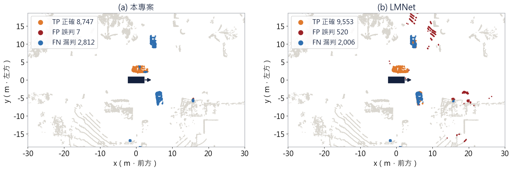

# mini-DATMO：以 LiDAR 幾何一致性自動標註移動物體

**Geometric Offline Labeling of Moving Points in LiDAR Sequences**

<p align="center">
  <br>
  <sub><b>圖 1.</b> SemanticKITTI 序列 08 第 45 幀的逐點標籤與人工標註比較。(a) 本專案，(b) LMNet [2] 官方預測。橘：正確（TP）；紅：誤判（FP）；藍：漏判（FN）。</sub>
</p>

## 摘要

移動物體分割（Moving Object Segmentation, MOS）的網路需要大量逐點標籤，而人工標註成本高。本專案使用 LiDAR 點雲與已知位姿，自動產生移動物體的逐點標籤：以 Wang 等人 [1] §7.1 的一致性判斷找出候選移動點，再參考 AutoMOS [3] 的流程，以分群、多目標追蹤與軌跡層級的判斷整理成標籤，最後以 SemanticKITTI [4] 的人工標籤評估。第一版只比較前後 0.5 秒，序列 08 的 moving IoU 為 35.7%。之後逐階段統計漏失並修改五處，影響最大的兩處是：參考幀在該方向沒有回波時不再視為看穿，以及沿著移動軌跡標註物體暫時停下的片段。目前序列 08 為 54.4%（precision 89.7%、recall 58.0%），序列 07 為 85.6%，未參與調整的官方測試集（序列 11–21）為 51.2%。序列 08 剩下的漏判主要來自觀察期間幾乎沒有移動的物體。

## 1. 方法

<p align="center">
  <br>
  <sub><b>圖 2.</b> 一致性偵測的結果。(a) 候選移動點，(b) 人工標註的移動點。人工標註另外包含兩台停在路口的車。</sub>
</p>

流程分為六個步驟，以 Python（NumPy、SciPy、scikit-learn）實作，程式在 `mini_datmo/`。

**1.1 位姿對齊。** SemanticKITTI 的位姿 $`P_k`$ 定義在左相機座標系。以 LiDAR 至相機的外參 $`T_r`$ 換到 LiDAR 座標系：

```math
T^{w}_{v,k} = T_r^{-1}\, P_k\, T_r .
```

檢查方式：取序列 08 第 1000 幀與第 995 幀（期間自車移動 2.37 m）感測器 30 m 內的非地面點，各自轉到世界座標後，計算第 1000 幀每一點到第 995 幀最近點的距離中位數。不轉換時為 0.527 m，以 $`T^{w}_{v,k}`$ 轉換後為 0.060 m；若把相機位姿 $`P_k`$ 直接套在 LiDAR 點上、不做共軛，為 2.670 m，比不轉換更差（[kitti_io.py](mini_datmo/kitti_io.py)、[檢查結果](results/pose_check.txt)）。

**1.2 去地面與車身。** 將點投影到 1 m × 1 m 的格子，取每格的最低點 $`z_{\min}`$。滿足 $`z - z_{\min} < 0.25`$ m 且 $`z_{\min} < -1.3`$ m 的點視為地面。感測器水平距離 2.0 m 以內的點視為自身車體；未排除時，這些點在世界座標中隨車移動，會被追蹤成一條很長的「移動物體」軌跡（[ground.py](mini_datmo/ground.py)）。

**1.3 一致性偵測。** 對參考幀 $`j`$，在其感測器座標下，以第 $`j`$ 幀的所有點（含地面）建立仰角 1° × 方位角 0.5° 的極座標距離圖（仰角 −26° 至 +4°），每格記錄光束第一次打到物體的距離，再取相鄰 3 × 3 格中的最小值作為 $`r_{\text{ref}}`$，使判斷偏保守。只判斷第 $`k`$ 幀中非地面、非車身、且距感測器水平 40 m 以內的點：將這些點以 $`(T^{w}_{v,j})^{-1}T^{w}_{v,k}`$ 轉到參考幀，得到它們與參考幀感測器的距離 $`r`$，若

```math
r < r_{\text{ref}} - (\delta_a + \delta_r\, r), \qquad \delta_a = 0.5\ \text{m},\ \delta_r = 0.02,
```

且 $`r_{\text{ref}}`$ 為有限值（參考幀在該方向確實有回波），代表該點落在參考幀光束曾經穿過的空間。沒有回波的格子只代表沒有資訊；若也當成看穿，離參考幀較遠的點幾乎都會得到一票（見第 2 節的回波實驗）。參考幀取 $`j = k \pm \{5, 10, 20, 40, 80\}`$（前後 0.5 至 8 秒，共 10 幀），其中至少 3 幀成立的點列為候選點；序列開頭與結尾的參考幀不足 3 幀時，門檻為現有參考幀的數量。仰角範圍以外的方向沒有資訊，不投票。點在參考幀中被較近的物體遮住時（$`r_{\text{ref}} < r`$），該參考幀也不投票（[polar.py](mini_datmo/polar.py)、[consistency.py](mini_datmo/consistency.py)）。[1] 將地圖轉到目前的視角比較；本專案將目前的點轉到參考幀的視角。因為目標是離線標註，可以使用未來的幀。

**1.4 分群與追蹤。** 距候選點 0.5 m（x-y 平面）以內的非地面點，以 DBSCAN 在 x-y 平面分群（半徑 $`\varepsilon = 1`$ m，對應 [1] §5.1）；只對候選點附近分群是 AutoMOS 的做法。最長邊小於 20 m（AutoMOS 的 $`T_{\text{size}}`$）且候選點比例 ≥ 0.05 的群，其中心以等速 Kalman filter 追蹤；配對以馬氏距離 $`d^2 = \mathbf{y}^\top S^{-1}\mathbf{y} \le \chi^2_{2,\,0.99} = 9.21`$ 作為 gate，再以匈牙利演算法求解（[cluster.py](mini_datmo/cluster.py)、[tracker.py](mini_datmo/tracker.py)）。

**1.5 軌跡層級判斷。** 一條 track 同時滿足長度 ≥ 5 幀、直線度（淨位移 ÷ 路徑長）≥ 0.6、淨位移大於外框最長邊、平均候選點比例 > 0.15，則判為移動；其所有幀的群內，距候選點 0.5 m 以內的點標為移動（[labeler.py](mini_datmo/labeler.py)）。此步驟參考 AutoMOS 的流程，但候選方法、配對與軌跡條件並不相同。

**1.6 停留延伸（補標暫停的物體）。**

一台車開到路口等紅燈時，SemanticKITTI 也把它等紅燈的那幾幀標為移動。如果前後幀都看到車佔著同一個位置，1.3 就缺少「這個位置曾經是空的」的證據，軌跡也可能在這裡斷掉。為了補回漏標，我們從已判為移動的軌跡出發，逐幀找回停在原地的那台車。

1. **從接近停下的軌跡端點出發。** 在軌跡的開頭或結尾，各取最靠近端點的 10 筆點群。若它們的中心在水平方向都離端點中心不超過 2 m，就從這一端開始找。從開頭往更早的幀找，可以補起步前的點。從結尾往更晚的幀找，可以補停下後的點。
2. **用上一次找到的外框，在相鄰幀找同一台車。** 先把點轉到世界座標，讓停著的車在各幀都落在同一個位置附近。把外框向外放寬 0.2 m，框內的非地面、非自車點當作「種子」。對附近的點做 DBSCAN（水平鄰近半徑 0.5 m），選出包含最多種子的那一群。若這群的水平外框最長邊不超過 8 m，就先收下這群點並更新外框。找不到符合條件的群時沿用上次的外框，連續失敗超過 20 幀就停止。
3. **確認原軌跡真的走得夠遠，再補上標籤。** 以延伸時找到的各群外框最長邊取中位數，估計物體大小。原軌跡頭尾的直線距離須至少 2 m，且至少是物體大小的 1.5 倍，才把延伸時找到的整群點標為移動。這可減少一種誤判，例如雷射先掃到一台停放車輛的車頭，後來掃到車尾，讓點群中心看起來在移動。

這是本專案的離線補標步驟，實作見 [`_extend_stops`](mini_datmo/labeler.py#L137)。圖 4 示範如何從已找到的起步軌跡，往回補上車子還停著時的點。

<p align="center">
  
  <br>
  <sub><b>圖 3.</b> (a) 第 45 幀的分群，橘色為送入追蹤的群；(b) 第 0–199 幀所有 track 在世界座標中的軌跡，橘色為判為移動者。</sub>
</p>

<p align="center">
  <br>
  <sub><b>圖 4.</b> 序列 08 的補標個案。從已確認的起步軌跡往回補標車子還停著的片段。</sub>
</p>

## 2. 實驗與改進

以 SemanticKITTI 序列 08 和 07 的人工標註為對照，逐步檢查移動點從哪一步開始漏掉，以及誤標在哪一步出現。位姿先按 1.1 驗證，接著用逐階段統計定位問題。 [漏失與誤判統計](results/funnel_seq08.txt)

- **前處理與分群。** 第一版會把鄰車道的車當成自車的一部分，也會把車和附近的牆或植被併進同一群。縮小自車遮罩後，序列 08 在地面與自車過濾階段流失的真值移動點由 13.6% 降到 6.3%。分群則改在候選點附近進行，減少納入周圍背景。 [第一版統計](results/funnel_seq08_first.txt) · [修改後統計](results/funnel_seq08.txt)
- **候選點與 LiDAR 回波。** 拉長參考時間一度看似能找回更多車，追查後才發現沒有回波的方向也被算成「雷射曾穿過」。要求以較遠的實際回波當證據後，在相同參考範圍和票數門檻下，序列 08 的候選點精確率從 23.1% 升到 78.1%。在這次抽樣中，修正後再拉長時間也沒有提高物體召回率。 [修正前的候選評估](results/candidate_recall_seq08_noreturn.txt) · [修正後](results/candidate_recall_seq08.txt)
- **軌跡判斷。** 試過用累積路徑長度判斷物體是否移動。在序列 08 的第一版設定下，召回率沒有提升，精確率卻從 73.7% 降到 56.2%。靜止物體每幀被掃到的部位不同，群中心的小幅抖動也會累加，所以保留頭尾淨位移。 [第一版對照](results/funnel_seq08_first.txt)

**結果。** 以整段序列的逐點標籤計算，序列 08 和 07 的移動點 IoU 分別為 54.4% 和 85.6%。部分設定是在看過兩段序列後選定，這些結果用來說明修改在這兩段資料上的效果。 [完整結果與對照](results/) · [LMNet 與官方計分方式](results/eval_protocols.txt)

**測試集。** 以相同的預設設定標註 SemanticKITTI 測試序列 11–21，提交到官方 Codabench 評分伺服器，moving IoU 為 51.2%。測試集的人工標籤不公開，沒有參與任何設定的選擇。官方計分忽略 unlabeled／outlier 點，同一口徑下序列 08 為 55.6%。

## 3. 目前限制

- **暫停太久的車容易漏標。** 序列 08 開頭的兩台車在 LiDAR 看得到的期間幾乎沒動，程式很難找到可用的移動軌跡，停留延伸也就接不上。 [暫停車輛分析](results/stopped_objects_seq08.txt)
- **局部動作容易漏標。** 例如路邊停著的車開門，車門的點可能出現移動候選。若車門和車身仍分在同一群，整群中心的位移可能太小，最後就不會標成移動。 [軌跡判斷](mini_datmo/labeler.py#L94-L113)
- **慢速物體容易被判為靜止。** 每幀掃到的車身部位不同，點群中心會抖動，讓軌跡看起來不夠直。序列 08 的慢速組中，有 18.1% 的真值移動點在停留延伸前因軌跡直線度不足而被排除。 [漏失統計](results/funnel_seq08.txt)
- **植被也可能被追成移動物體。** 序列 08 的誤判包含整條軌跡都沒有真值移動點的案例，常見來源是植被和樹幹。 [誤判來源](results/funnel_seq08.txt)

停留延伸的門檻是看過序列 07 和 08 後選定的。測試集只有整體分數，無法單獨看出停留延伸的效果。

## 4. 重現

在 repo 根目錄安裝依賴：

```bash
pip install -r mini_datmo/requirements.txt
```

序列 08 使用 [LiDAR-MOS](https://github.com/PRBonn/LiDAR-MOS) 提供的 toy dataset（點雲、位姿、人工標籤與 LMNet 預測），解壓到 `datasets/lmnet_toy_seq08/`。其他序列以下載腳本透過 HTTP Range 取得指定序列的點雲；人工標籤與位姿另從 [SemanticKITTI 標籤包](https://www.semantic-kitti.org/assets/data_odometry_labels.zip) 取得，序列 07 的資料目錄為 `datasets/semantickitti/dataset/sequences/07/`。

```bash
python mini_datmo/tools/fetch_sequences.py 07 --out datasets/semantickitti

cd mini_datmo
python checks/check_step0.py > ../results/pose_check.txt              # 1.1 位姿對齊的檢查
python run.py --data seq08 --out out/seq08                             # 完整標註
python run.py --data seq07 --out out/seq07                             # 完整標註
python run.py --data seq08 --kw "stop_extend=False"                    # 關閉停留延伸
OLD="need_return=False,stop_extend=False"                              # 早期設定：無回波可投票，關閉停留延伸
python run.py --data seq08 --kw "$OLD"                                 # 早期設定：群上限 20 m
python run.py --data seq08 --kw "max_extent_track=8,$OLD"              # 早期設定：群上限 8 m
python run.py --data seq08 --gap 5 --min-votes 1 --kw "cand_grow=0,max_extent_track=8,$OLD"                  # 縮小自車遮罩
python run.py --data seq08 --gap 5 --min-votes 1 --kw "ego_radius=2.8,cand_grow=0,max_extent_track=8,$OLD"   # 第一版
python checks/eval_protocols.py --data seq08 --pred out/seq08          # 官方評估方式
python checks/candidate_recall.py --data seq08                         # 候選評估（要求回波）
python checks/candidate_recall.py --data seq08 --det-kw "need_return=False"   # 候選評估（不要求回波）
python eval_by_speed.py --pred out/seq08/predictions                   # 依速度分組評估
python checks/funnel.py --data seq08                                   # 誤差分析：各階段的漏失與誤判來源
python checks/stopped_oracle.py --pred out/seq08/predictions           # 誤差分析：暫停的點來自哪些物體
python checks/try_stop_extend.py --data seq07 --frames 0:1101          # 每一個停留延伸的結果
python report/make_figures.py                                          # 圖 1–4
```

| 檔案 | 內容 |
|---|---|
| `kitti_io.py` | 讀取 SemanticKITTI 與 KITTI raw，位姿轉換 |
| `ground.py` | 去地面、去車身 |
| `polar.py`、`consistency.py` | 極座標距離圖與一致性偵測 |
| `cluster.py`、`tracker.py` | DBSCAN 分群；Kalman filter、馬氏距離 gate、匈牙利配對 |
| `labeler.py` | 標註流程：候選、分群、追蹤、軌跡層級判斷、停留延伸 |
| `evaluate.py`、`eval_by_speed.py` | 評估、速度分組 |
| `checks/check_step0.py` | 位姿對齊的檢查 |
| `checks/funnel.py`、`checks/candidate_recall.py`、`checks/eval_protocols.py` | 各階段漏失統計、候選階段召回率、兩種評估方式 |
| `checks/stopped_oracle.py`、`checks/try_stop_extend.py` | 暫停的點屬於哪些物體、每一個停留延伸的結果 |

## 參考文獻

1. C.-C. Wang, C. Thorpe, M. Hebert, S. Thrun, and H. Durrant-Whyte, "Simultaneous Localization, Mapping and Moving Object Tracking," *The International Journal of Robotics Research*, 2007.
2. X. Chen et al., "Moving Object Segmentation in 3D LiDAR Data: A Learning-Based Approach Exploiting Sequential Data," *IEEE Robotics and Automation Letters*, 2021.
3. X. Chen et al., "Automatic Labeling to Generate Training Data for Online LiDAR-Based Moving Object Segmentation," *IEEE Robotics and Automation Letters*, 2022.
4. J. Behley et al., "SemanticKITTI: A Dataset for Semantic Scene Understanding of LiDAR Sequences," *Proc. IEEE/CVF International Conference on Computer Vision (ICCV)*, 2019.
