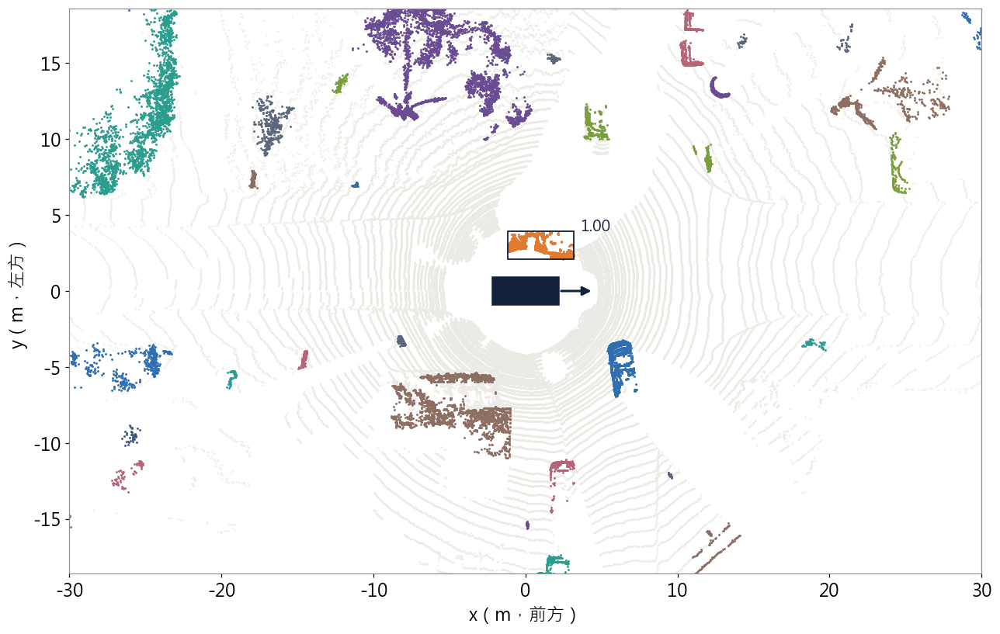
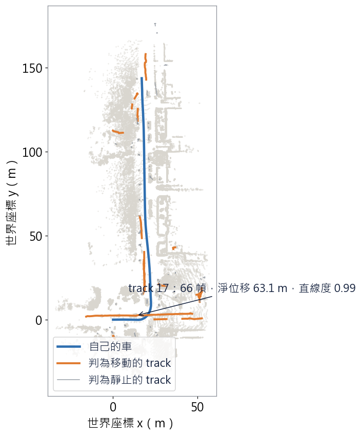

# mini-DATMO：以 LiDAR 幾何一致性自動標註移動物體

**Geometric Offline Labeling of Moving Points in LiDAR Sequences**

<p align="center">
  <br>
  <sub><b>圖 1.</b> SemanticKITTI 序列 08 第 45 幀的逐點標籤與人工標註比較。(a) 本專案，(b) LMNet [2] 官方預測。橘：正確（TP）；紅：誤判（FP）；藍：漏判（FN）。</sub>
</p>

## 摘要

移動物體分割（Moving Object Segmentation, MOS）的網路需要大量逐點標籤，而人工標註成本高。本專案使用 LiDAR 點雲與已知位姿，自動產生移動物體的逐點標籤：以 Wang 等人 [1] §7.1 的一致性判斷找出候選移動點，再參考 AutoMOS [3] 的流程，以分群、多目標追蹤與軌跡層級的判斷整理成標籤，最後以 SemanticKITTI [4] 的人工標籤評估。序列 08 的 moving IoU 為 35.3%；對估計速度大於 2 m/s 的物體，召回率為 74.2%，慢速與暫時停住的物體仍容易漏掉。以此標籤去除移動點後建圖，序列 08 `3900:4071` 幀累積地圖中的移動物體殘影減少 71%。

## 1. 方法

<p align="center">
  <br>
  <sub><b>圖 2.</b> 一致性偵測的結果。(a) 候選移動點，(b) 人工標註的移動點。人工標註另外包含兩台停在路口的車。</sub>
</p>

流程分為五個步驟，以 Python（NumPy、SciPy、scikit-learn）實作，程式在 `mini_datmo/`。

**1.1 位姿對齊。** SemanticKITTI 的位姿 $P_k$ 定義在左相機座標系。以 LiDAR 至相機的外參 $T_r$ 換到 LiDAR 座標系：

$$T^{w}_{v,k} = T_r^{-1}\, P_k\, T_r .$$

相隔 5 幀的非地面點，最近點距離中位數由未轉換時的 0.471 m 降為 0.059 m（[kitti_io.py](mini_datmo/kitti_io.py)）。

**1.2 去地面與車身。** 將點投影到 1 m × 1 m 的格子，取每格的最低點 $z_{\min}$。滿足 $z - z_{\min} < 0.25$ m 且 $z_{\min} < -1.3$ m 的點視為地面。感測器水平距離 2.8 m 以內的點視為自身車體；未排除時，這些點在世界座標中隨車移動，會被追蹤成一條很長的「移動物體」軌跡（[ground.py](mini_datmo/ground.py)）。

**1.3 一致性偵測。** 對參考幀 $j \in \{k-5,\, k+5\}$，在其感測器座標下建立仰角 1° × 方位角 0.5° 的極座標距離圖，每格記錄光束第一次打到物體的距離 $r_{\text{ref}}$。將第 $k$ 幀的點以 $(T^{w}_{v,j})^{-1}T^{w}_{v,k}$ 轉到參考幀，若

$$r < r_{\text{ref}} - (\delta_a + \delta_r\, r), \qquad \delta_a = 0.5\ \text{m},\ \delta_r = 0.02,$$

代表該點落在參考幀光束曾經穿過的空間，列為候選點（[polar.py](mini_datmo/polar.py)、[consistency.py](mini_datmo/consistency.py)）。[1] 將地圖轉到目前的視角比較；本專案將目前的點轉到參考幀的視角，並同時比較前、後兩幀。因為目標是離線標註，可以使用未來的幀。

**1.4 分群與追蹤。** 非地面點以 DBSCAN 在 x-y 平面分群（$\varepsilon = 1$ m，對應 [1] §5.1）。候選點比例 ≥ 0.05 的群，其中心以等速 Kalman filter 追蹤；配對以馬氏距離 $d^2 = \mathbf{y}^\top S^{-1}\mathbf{y} \le \chi^2_{2,\,0.99} = 9.21$ 作為 gate，再以匈牙利演算法求解（[cluster.py](mini_datmo/cluster.py)、[tracker.py](mini_datmo/tracker.py)）。

**1.5 軌跡層級判斷。** 一條 track 同時滿足長度 ≥ 5 幀、直線度（淨位移 ÷ 路徑長）≥ 0.6、淨位移大於外框最長邊、平均候選點比例 > 0.15，則其所有幀的點標為移動（[labeler.py](mini_datmo/labeler.py)）。此步驟參考 AutoMOS 的流程，但分群、配對與軌跡條件並不完全相同。

<p align="center">
  
  <br>
  <sub><b>圖 3.</b> (a) 第 45 幀的 DBSCAN 分群，橘色為送入追蹤的群；(b) 第 0–199 幀所有 track 在世界座標中的軌跡，橘色為判為移動者。</sub>
</p>

## 2. 實驗

**資料與指標。** SemanticKITTI 序列 08（4,071 幀，移動點占 0.33%）與序列 07（1,101 幀）。Precision、recall 與 IoU $= \text{TP}/(\text{TP}+\text{FP}+\text{FN})$ 皆將評估範圍內各幀的 TP、FP、FN 加總後計算（[evaluate.py](mini_datmo/evaluate.py)）。LMNet 使用 LiDAR-MOS toy dataset 附的 SalsaNext 預測（1 張殘差影像），未另外訓練網路。

**表 1.** 逐點分割結果（%）。來源：[序列 08](results/seq08_full_g5.json)、[序列 07](results/seq07_g5.json) 的 `all` 指標。

| 方法 | 評估範圍 | Precision | Recall | IoU |
|---|---|---:|---:|---:|
| 本專案 | 序列 08 全部 4,071 幀 | 67.9 | 42.3 | 35.3 |
| LMNet 官方預測 [2] | 序列 08 全部 4,071 幀 | 75.5 | 72.1 | 58.4 |
| 本專案 | 序列 07 全部 1,101 幀 | 54.1 | 43.9 | 32.0 |

LMNet 論文 Table I 報告的 IoU 為 59.9%；以附帶預測重算為 58.4%，差異原因尚未確認。

作為方法上的參考，AutoMOS [3] Table I 在 SemanticKITTI 訓練序列上的結果為：visibility-based baseline P 76.8 / R 41.2 / IoU 36.6；完整方法（ERASOR）P 88.1 / R 82.5 / IoU 74.2。本專案與 visibility-based baseline 的 IoU 數字接近，但評估序列不同，尚不能據此說兩者效果相當；本專案也沒有重現 AutoMOS 的完整方法。

**表 2.** 開發範圍上的比較（%）：序列 08 `1500:1800` 與 `3000:3300`，共 600 幀（[checks/dev_eval.py](mini_datmo/checks/dev_eval.py)）。refine 指判為移動的群內，只保留距候選點 0.5 m 以內的點，以減少相鄰物體黏在同一群造成的誤判。

| 方法 | Precision | Recall | IoU |
|---|---:|---:|---:|
| 本專案 | 77.6 | 50.5 | 44.1 |
| 本專案 + refine | 86.0 | 49.6 | 45.9 |
| LMNet 官方預測 | 69.3 | 71.6 | 54.4 |

此範圍用於調整方法，不能當作完整序列的改善幅度。

**誤差分析。** 序列 08 開頭有兩台車停在路口，觀察期間幾乎沒有移動，人工標籤仍標為移動。為區分「所有物體都抓不好」與「主要漏在慢速和停住的物體」，依估計速度分組計算 recall（表 3）。速度由真值物體點雲中心在前後幀的位移估計；遮擋與可見表面改變也會使中心漂移，因此分組只是近似。

**表 3.** 依估計速度分組的 recall（%），序列 08 完整序列、未加 refine。來源：[速度分組結果](results/seq08_g5_by_speed.json)。

| 估計速度 | 占真值移動點（約） | 本專案 | LMNet |
|---|---:|---:|---:|
| < 0.5 m/s | 21 | 0.0 | 42.1 |
| 0.5–2 m/s | 28 | 15.8 | 62.5 |
| > 2 m/s | 51 | 74.2 | 89.9 |

差距在慢速與停住的組別特別明顯。0.5 秒內的位移小於容許值時，光束不會穿過物體原本的位置；[1] §7.1 亦指出此方法無法偵測暫時靜止的物體。LMNet 對停住的物體也有部分召回，可能與訓練學到的特徵有關，但目前的實驗還不能確認原因。

<p align="center">
  <br>
  <sub><b>圖 4.</b> 一台約 1 m/s 的車。群中心的抖動大於實際位移，軌跡斷成兩段，淨位移皆未達外框長度，因此被判為靜止。</sub>
</p>

**應用：建圖。** 以位姿將序列 08 `3900:4071` 幀（右端不含）累積成地圖（0.2 m voxel）。鬼影只計算完全由真值移動點組成的 voxel（[mapping.py](mini_datmo/mapping.py)、[建圖結果](results/seq08_3900-4071.json)）。未去除移動點時有 13,101 個；以本專案標籤去除後剩 3,787 個（−71%），以 LMNet 官方預測去除後剩 2,472 個（−81%）。本專案保留了 99.92% 的純靜態 voxel。

<p align="center">
  <br>
  <sub><b>圖 5.</b> 累積地圖。由左至右：未處理、本專案、LMNet、人工標註；紅色為殘留在地圖中的移動點。</sub>
</p>

## 3. 限制與未來工作

- **時間範圍。** 拉長比較的時間範圍後，候選點的 recall 提高，但完整序列的最終 IoU 下降：多間隔比較為 30.6%，長時間比較為 31.3%，皆低於基準的 35.3%（[多間隔結果](results/seq08_full_g5-10-20.json)、[長時間結果](results/seq08_full_h145v3.json)）。AutoMOS 以 ERASOR 產生候選後仍能維持高 precision；本專案增加時間範圍後，未能有效濾掉多出來的誤判。下一步先釐清問題出在候選、分群還是追蹤。
- **判斷規則。** 淨位移對慢速物體過於嚴格；可改用 AutoMOS 的累積軌跡長度，並檢驗對靜止物體的誤判。
- **追蹤器。** 目前為單一等速模型與單一假設；[1] 使用 IMM 與 MHT。
- **尚未完成。** 位姿雜訊對標註品質的影響，以及以自動標籤訓練線上網路。

## 4. 重現

在 repo 根目錄安裝依賴：

```bash
pip install -r mini_datmo/requirements.txt
```

序列 08 使用 [LiDAR-MOS](https://github.com/PRBonn/LiDAR-MOS) 提供的 toy dataset（點雲、位姿、人工標籤與 LMNet 預測），解壓到 `datasets/lmnet_toy_seq08/`。其他序列以下載腳本透過 HTTP Range 取得指定序列的點雲；人工標籤與位姿另從 [SemanticKITTI 標籤包](https://www.semantic-kitti.org/assets/data_odometry_labels.zip) 取得，序列 07 的資料目錄為 `datasets/semantickitti/dataset/sequences/07/`。

```bash
python mini_datmo/tools/fetch_sequences.py 07 --out datasets/semantickitti

cd mini_datmo
python run.py --data seq08 --out out/seq08_g5                          # 表 1
python run.py --data seq07 --out out/seq07_g5                          # 表 1
python checks/dev_eval.py                                              # 表 2
python checks/dev_eval.py "refine=0.5"                                 # 表 2
python eval_by_speed.py --pred out/seq08_g5/predictions                # 表 3
python mapping.py --pred out/seq08_g5/predictions --frames 3900:4071   # 圖 5
python report/make_figures.py                                          # 圖 1–4
```

| 檔案 | 內容 |
|---|---|
| `kitti_io.py` | 讀取 SemanticKITTI 與 KITTI raw，位姿轉換 |
| `ground.py` | 去地面、去車身 |
| `polar.py`、`consistency.py` | 極座標距離圖與一致性偵測 |
| `cluster.py`、`tracker.py` | DBSCAN 分群；Kalman filter、馬氏距離 gate、匈牙利配對 |
| `labeler.py` | 三階段標註流程與軌跡層級判斷 |
| `evaluate.py`、`eval_by_speed.py`、`mapping.py` | 評估、速度分組、建圖 |

## 參考文獻

1. C.-C. Wang, C. Thorpe, M. Hebert, S. Thrun, and H. Durrant-Whyte, "Simultaneous Localization, Mapping and Moving Object Tracking," *The International Journal of Robotics Research*, 2007.
2. X. Chen et al., "Moving Object Segmentation in 3D LiDAR Data: A Learning-Based Approach Exploiting Sequential Data," *IEEE Robotics and Automation Letters*, 2021.
3. X. Chen et al., "Automatic Labeling to Generate Training Data for Online LiDAR-Based Moving Object Segmentation," *IEEE Robotics and Automation Letters*, 2022.
4. J. Behley et al., "SemanticKITTI: A Dataset for Semantic Scene Understanding of LiDAR Sequences," *Proc. IEEE/CVF International Conference on Computer Vision (ICCV)*, 2019.
